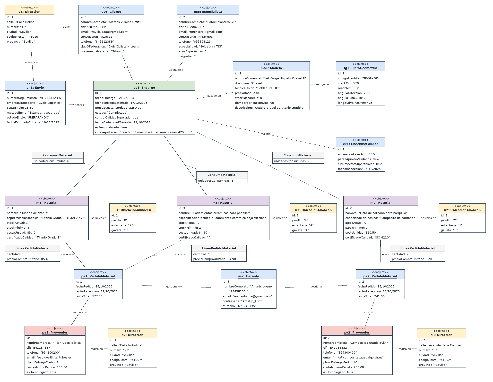

# VeloForge: Ciclismo de alto rendimiento

## Miembros del grupo L3-ABS-5

1. Talavera Cano, Jesús Enrique
<<<<<<< HEAD
2. Ramos Zamora, Alberto
3. Domínguez Freire, Jose Luis
4. Thomas Abello, Arve

---

## 1. Introducción al problema

La empresa VeloForge nace de la pasión por el ciclismo de alto rendimiento y la ingeniería mecánica, con la ambición de convertirse en un taller de referencia en la fabricación artesanal de cuadros a medida (*bespoke*) y el ensamblaje de bicicletas de competición. Como taller en fase de expansión, su principal reto es competir con las grandes corporaciones industriales que operan con producciones masivas de bajo coste y geometrías estándar, demostrando el valor diferencial de la personalización biomecánica, la durabilidad y la excelencia de la fabricación a mano.
=======
1. Ramos Zamora, Alberto
1. Domínguez Freire, Jose Luis

## 1. Introducción al problema

La empresa VeloForge nace de la pasión por el ciclismo de alto rendimiento y la ingeniería mecánica, con la ambición de convertirse en un taller de referencia en la fabricación artesanal de cuadros a medida (bespoke) y el ensamblaje de bicicletas de competición. Como taller en fase de expansión, su principal reto es competir con las grandes corporaciones industriales con producciones masivas de bajo coste, demostrando el valor diferencial de la personalización, la durabilidad y la excelencia de la fabricación a mano.
La gestión artesanal del taller requiere coordinar el abastecimiento de materiales, la asignación de carga de trabajo, y un riguroso control de tolerancias mecánicas. Por ello, es necesario desarrollar un software integral que aborde una doble necesidad estratégica: crecer de cara al público y optimizar la gestión técnica interna.
>>>>>>> c5bd7ab3346bebf13ce72e76c45b4fc1678b28a3

La gestión artesanal del taller requiere coordinar el abastecimiento de materiales técnicos, la asignación equilibrada de la carga de trabajo en los bancos de taller y un riguroso control de tolerancias mecánicas. Por ello, es necesario desarrollar un software integral que aborde una doble necesidad estratégica: ofrecer un canal transparente y personalizado de cara al cliente y optimizar la gestión técnica y operativa interna.

---

## 2. Glosario de términos

- **Alineación láser**: Procedimiento metrológico de precisión mediante el cual se comprueba en mesa de control que las punteras y los ejes del cuadro son estrictamente coplanares (con una tolerancia inferior a 0.2 mm).
- **Artesanía ciclista**: Fabricación manual e individualizada de cuadros y componentes, empleando técnicas tradicionales de soldadura, conformado de tubos y laminado de fibras.
<<<<<<< HEAD
- **Bespoke (A medida)**: Capacidad de diseñar y construir una bicicleta adaptada de forma única a las dimensiones antropométricas y a las preferencias de rendimiento del ciclista.
=======
- **Bespoke (A medida)**: Capacidad de diseñar y construir una bicicleta adaptada de forma única a las dimensiones y a las preferencias de rendimiento del cliente.
>>>>>>> c5bd7ab3346bebf13ce72e76c45b4fc1678b28a3
- **Cerámica (Rodamientos)**: Componentes mecánicos de baja fricción empleados en pedalieres y bujes para optimizar la eficiencia y suavidad de rodadura.
- **Cuadro**: Estructura principal o chasis de la bicicleta sobre la que se ensamblan la horquilla, ruedas, grupo de transmisión y demás componentes.
- **Diseño biomecánico**: Estudio ergonómico y cinemático del ciclista que determina las cotas exactas para maximizar la comodidad y la transferencia de potencia.
- **Garantía estructural**: Cobertura técnica ofrecida por el taller frente a roturas, defectos de soldadura o fallos de fatiga en los materiales del cuadro.
<<<<<<< HEAD
- **Geometría de catálogo**: Conjunto estandarizado de ángulos y longitudes predefinidas para fabricar cuadros bajo demanda sin requerir un estudio biomecánico previo.
=======
- **Geometría de catálogo**: Conjunto estandarizado de ángulos y longitudes predefinidas para fabricar cuadros bajo demanda sin requerir un estudio específico.
>>>>>>> c5bd7ab3346bebf13ce72e76c45b4fc1678b28a3
- **Libro de Geometrías**: Registro técnico (físico y digital) donde se archivan los planos, esquemas dimensionales y especificaciones de materiales de los diseños propios del taller.
- **Racores**: Piezas de unión metálicas que abrazan los tubos del cuadro para unirlos mediante soldadura blanda o por capilaridad.
- **Restauración estructural**: Servicio técnico destinado a reparar fisuras, alinear cuadros deformados y renovar acabados de bicicletas de alto valor.
- **Soldadura TIG**: Técnica de unión manual por arco eléctrico, esencial para soldar titanio y aceros especiales sin introducir impurezas.
- **Titanio Grado 9 (Ti-3Al-2.5V)**: Aleación de titanio con 3% de aluminio y 2.5% de vanadio, referente en el sector por su ligereza, resistencia a la corrosión y capacidad de absorción de impactos.
- **Wheelbuilding**: Proceso artesanal de cálculo de longitud de radios, cruces, radiado y centrado milimétrico de ruedas de competición.

---

## 3. Visión general del sistema

### 3.1. Requisitos generales

- **Gestión del inventario**:
  Es imprescindible estar al tanto de los materiales y componentes almacenados y reponer con facilidad aquellos que se hayan agotado o estén bajo stock de seguridad, garantizando que cumplan las certificaciones técnicas para ofrecer bicicletas fiables.

- **Gestión de pedidos y proyectos**:
  Estar informado de las demandas de los clientes para organizar a los especialistas de taller, acortando los periodos de espera y ofreciendo un seguimiento claro de cada fase de fabricación.

- **Gestión económica y presupuestos**:
  Conocer los costes de aprovisionamiento, horas de taller imputadas y facturación en orden cronológico, informando al gerente de los márgenes de beneficio por proyecto para mantener la viabilidad financiera del negocio.

- **Gestión del catálogo y geometrías**:
  Disponer de un registro de los modelos base, cotas de geometría y especificaciones de materiales homologadas para agilizar la producción de serie y servir de base a los proyectos personalizados.

- **Gestión de clientes y biomecánica**:
  Mantener un registro de los clientes particulares y clubes, integrando sus datos de contacto, historial de pedidos y medidas ergonómicas.

<<<<<<< HEAD
- **Gestión de especialistas**:
  Disponer del registro del personal técnico de taller, identificando sus especialidades (*framebuilding*, montaje o acabados) y experiencia para controlar la asignación de proyectos y validar la incorporación de nuevos artesanos.
=======
**Gestión de especialistas**:
Es necesario tener un registro donde aparezcan todos los artesanos y técnicos de taller, donde podremos encontrar sus datos personales, vías de contacto y sus especialidades dentro del sector, así como un canal de captación y evaluación de nuevos perfiles profesionales externos que permita al dueño analizar candidaturas y gestionar la contratación de nuevos especialistas para el taller.
>>>>>>> c5bd7ab3346bebf13ce72e76c45b4fc1678b28a3

### 3.2. Usuarios del sistema

- **Dueño**: Responsable estratégico y financiero del taller; supervisa márgenes de rentabilidad, aprueba contrataciones e inversiones.
- **Cliente (Ciclistas, Clubes deportivos)**: Usuario que consulta el catálogo, formaliza encargos (estándar o a medida) y realiza el seguimiento online de su fabricación.
- **Especialista (Constructor / Montador)**: Artesano del taller responsable de cortar, soldar, laminar o ensamblar los componentes. Consulta las cotas técnicas y actualiza el avance de los trabajos.
- **Gerente**: Encargado de coordinar el taller, gestionar el inventario, tramitar compras a proveedores, emitir facturas y supervisar el cumplimiento de plazos y calidades.
- **Proveedor**: Empresa suministradora de tubería técnica, componentes mecánicos y consumibles homologados.
- **Administrador Web**: Encargado del soporte técnico, mantenimiento de la plataforma y actualización de contenidos del catálogo.

---

## 4. Catálogo de requisitos

### 4.1. Requisitos funcionales

<<<<<<< HEAD
- **R.F.01. Consulta del Catálogo de Modelos**  
  Permite consultar el catálogo de bicicletas y el libro de geometrías, aplicando filtros combinados por disciplina ciclista (Carretera, Gravel, MTB, Pista) y técnica de unión.  
  *Pruebas de aceptación:*
  - Comprobar que el sistema muestra el catálogo de modelos y el libro de geometrías asociado.
  - Comprobar que se pueden filtrar los modelos por disciplina ciclista y técnica de unión.
  - Aplicar la regla de negocio **RN-06** para verificar que todo modelo estándar enlace a una ficha del Libro de Geometrías.

- **R.F.02. Consulta y Gestión de Especialistas**  
  Permite listar y consultar el perfil de los artesanos y mecánicos del taller, visualizando su especialidad técnica, biografía y experiencia para una adecuada asignación de trabajo o registro de personal.  
  *Pruebas de aceptación:*
  - Comprobar que el sistema lista a los especialistas del taller con su especialidad y años de experiencia.
  - Aplicar la regla de negocio **RN-07** para impedir el registro de especialistas con menos de 3 años de experiencia acreditada.

- **R.F.03. Consulta de Ficha de Cliente**  
  Permite al personal autorizado consultar los datos de un cliente, su historial de pedidos y sus parámetros biomecánicos mediante búsquedas por DNI o apellidos.  
  *Pruebas de aceptación:*
  - Comprobar que el sistema localiza clientes por identificador, nombre o club.
  - Comprobar que se detallan sus datos de contacto, encargos previos y especificaciones ergonómicas.
=======
**R.F.01. Consulta del Catálogo de Modelos**  
Como cliente quiero consultar el catálogo de bicicletas y el libro de geometrías, con la posibilidad de aplicar filtros por disciplina ciclista y técnica de unión para encontrar el modelo que mejor se adapte a mis necesidades e intereses.  
*Pruebas de aceptación:*
- Comprobar que el sistema muestra correctamente el catálogo completo de bicicletas y el libro de geometrías.
- Comprobar que el usuario puede filtrar los modelos seleccionando una disciplina ciclista específica.
- Comprobar que el usuario puede filtrar los modelos aplicando criterios de técnica de unión.
- Se debe aplicar la regla de negocio RN-06 para asegurar que todo modelo de catálogo esté registrado en el "Libro de Geometrías" interno con sus diagramas de cotas y especificaciones de tubería.

**R.F.02. Consulta de Perfiles de Especialistas**  
Como gerente o dueño quiero listar y comparar las especialidades y años de experiencia de los artesanos y mecánicos para asignar al trabajador óptimo en función de las exigencias técnicas del encargo.  
*Pruebas de aceptación:*
- Comprobar que el sistema lista correctamente a los artesanos y mecánicos del taller.
- Comprobar que se pueden filtrar según experiencia o especialidad técnica.

**R.F.03. Consulta de Ficha de Cliente**  
Como personal autorizado (Dueño/Gerente) quiero consultar y gestionar las preferencias y el historial de encargos de un cliente para mantener un seguimiento centralizado de su evolución técnica en el taller.  
*Pruebas de aceptación:*
- Comprobar que el sistema permite realizar búsquedas de clientes registrados por DNI o apellidos.
- Comprobar que se pueden realizar consultas filtrando por preferencias del cliente, medidas corporales o club ciclista.
- Comprobar que la ficha de cliente muestra la información personal, su historial de encargos y los parámetros o preferencias biomecánicas.
>>>>>>> c5bd7ab3346bebf13ce72e76c45b4fc1678b28a3

- **R.F.04. Listado General de Encargos**  
  Permite al gerente y al dueño supervisar todos los proyectos en curso, filtrando por estado de producción (*Diseño*, *Fabricación*, *Montaje*, *Completado*), cliente o especialista asignado.  
  *Pruebas de aceptación:*
  - Comprobar que se listan todos los proyectos del taller con su estado actual y fechas estimadas.
  - Comprobar el filtrado por estado, especialista y cliente.
  - Aplicar la regla de negocio **RN-01** para reflejar el cupo máximo de proyectos activos por especialista.

- **R.F.05. Consulta de Encargos para el Cliente**  
  Permite al cliente autenticado visualizar exclusivamente sus propios proyectos y el estado de avance en taller.  
  *Pruebas de aceptación:*
  - Comprobar que el cliente accede únicamente a la información de sus propios pedidos.
  - Comprobar que se muestra con claridad la fase técnica actual del encargo.

- **R.F.06. Consulta de Inventario de Materiales**  
  Permite consultar las existencias de materiales y componentes, mostrando stock disponible, coste unitario, ubicación en almacén y alertas de reposición.  
  *Pruebas de aceptación:*
  - Comprobar que se listan los materiales con su stock actual y ubicación física.
  - Aplicar la regla de negocio **RN-02** para validar que los materiales críticos cuentan con certificación técnica.

<<<<<<< HEAD
- **R.F.07. Consulta de Proveedores**  
  Permite al gerente listar los proveedores registrados, su estado de homologación, condiciones de suministro e histórico de compras.  
  *Pruebas de aceptación:*
  - Comprobar que se visualizan los datos de contacto y condiciones comerciales de cada proveedor.
  - Comprobar que se refleja el histórico de pedidos asociados a cada proveedor homologado.

- **R.F.08. Consulta de Informes Económicos**  
  Permite al dueño y al gerente generar informes agregados sobre facturación, costes de aprovisionamiento y balance económico por periodo.  
  *Pruebas de aceptación:*
  - Comprobar que el sistema permite seleccionar un rango de fechas para generar el informe.
  - Comprobar el cálculo correcto de ingresos, costes imputados y margen de beneficio.
=======
**R.F.07. Consulta de Proveedores**  
Como gerente o dueño quiero consultar y gestionar la homologación de certificaciones de los proveedores para controlar qué empresas cumplen los requisitos de calidad necesarios para suministrar materias primas al taller.  
*Pruebas de aceptación:*
- Comprobar que el sistema muestra un listado completo de los proveedores dados de alta.
- Comprobar que se muestra la información de contacto, las certificaciones homologadas y el historial de pedidos de cada proveedor.
- Se debe aplicar la regla de negocio RN-02 para verificar la homologación de los proveedores de titanio y composites.

**R.F.08. Consulta de Informes Económicos**  
Como gerente o dueño quiero listar y visualizar informes sobre ventas, costes de materiales y la relación coste-beneficio de los proyectos para analizar los datos en un período determinado.  
*Pruebas de aceptación:*
- Comprobar que se calculan y visualizan correctamente las ventas, los costes de materiales y la relación coste-beneficio de los proyectos en dicho período.
- Comprobar que el sistema permite seleccionar un intervalo de fechas para la generación de informes económicos.
>>>>>>> c5bd7ab3346bebf13ce72e76c45b4fc1678b28a3

- **R.F.09. Consulta y Seguimiento de Envíos**  
  Permite consultar los datos logísticos y el estado de expedición de las bicicletas y cuadros mediante el número de seguimiento.  
  *Pruebas de aceptación:*
  - Comprobar que el sistema recupera la información del transporte vinculado a un encargo.
  - Comprobar que se refleja el estado logístico (*En preparación*, *En camino*, *Entregado*).

<<<<<<< HEAD
---
=======
**R.F.10. Consultar y contratar especialistas**  
Como dueño, quiero poder consultar los perfiles de diferentes especialistas y contactar con ellos para contratar los servicios de aquellos que mejor se adapten a las necesidades de mi negocio.  
*Pruebas de aceptación:*
- Comprobar que el sistema permite consultar una lista de especialistas.
- Comprobar que el sistema permite acceder al perfil de cada especialista.
- Comprobar que el sistema muestra opciones para contactar con un especialista.
- El dueño puede seleccionar a los especialistas que considere adecuados para su negocio.
>>>>>>> c5bd7ab3346bebf13ce72e76c45b4fc1678b28a3

#### 4.1.1. Requisitos de información

- **RI-01: Modelos y Bicicletas**  
  Como especialista o gerente quiero consultar la información técnica de los modelos disponibles: denominación comercial, disciplina (carretera, gravel, pista), técnica de unión (soldadura TIG, racores, monocasco), materiales principales, descripción técnica, precio base, stock y plazo estimado de fabricación.  
  *Pruebas de aceptación:*
  - Comprobar que el sistema muestra los datos técnicos, precios y fotografías del modelo.
  - Comprobar la vinculación con el Libro de Geometrías según **RN-06**.

- **RI-02: Especialistas y Alta Técnica**  
  Como dueño quiero disponer de la información del equipo técnico (nombre completo, DNI, teléfono, email, especialidad, biografía y años de experiencia) para gestionar el taller y validar altas de nuevos especialistas.  
  *Pruebas de aceptación:*
  - Comprobar el almacenamiento y visualización del perfil técnico del especialista.
  - Aplicar la regla **RN-07** para validar que se rechazan altas con experiencia inferior a 3 años.

- **RI-03: Clientes y Parámetros Biomecánicos**  
  Como gerente y especialista quiero disponer de los datos del cliente (nombre, apellidos, DNI, teléfono, email, dirección, club/federación) y sus medidas biomecánicas (*stack*, *reach*, entrepierna, preferencias ergonómicas) para personalizar el diseño del cuadro.  
  *Pruebas de aceptación:*
  - Comprobar que se registran y consultan los datos personales y de localización del cliente.
  - Comprobar que los especialistas acceden a las cotas biomecánicas asociadas al cliente.

<<<<<<< HEAD
- **RI-04: Órdenes de Fabricación y Proyectos**  
  Como gerente quiero consultar toda la información de cada encargo: identificador único, cliente, especialista asignado, modelo base o personalizado, presupuesto cerrado, fecha de encargo, fecha estimada de entrega, estado de producción y resultado de control de calidad.  
  *Pruebas de aceptación:*
  - Comprobar que el encargo registra sus hitos de estado (*Diseño*, *Fabricación*, *Montaje*, *Completado*).
  - Aplicar **RN-01** para asegurar que no se sobrepase el límite de proyectos por artesano.
  - Aplicar **RN-03** para verificar que el checklist de calidad esté superado antes de finalizar.

- **RI-05: Inventario y Consumo de Materiales**  
  Como gerente quiero conocer el inventario de almacén (descripción del material, tipo de aleación o composite, proveedor habitual, coste unitario, stock actual, stock mínimo, ubicación en taller y certificado de calidad) y los consumos imputados a cada proyecto.  
  *Pruebas de aceptación:*
  - Comprobar que se lista el stock y la ubicación en almacén de cada insumo.
  - Aplicar **RN-02** para asegurar que la materia prima crítica dispone de certificado homologado.

- **RI-06: Proveedores Homologados**  
  Como gerente quiero disponer de la información de los proveedores: razón social, CIF, vías de contacto, dirección, tipos de material suministrado, plazo medio de entrega, pedido mínimo e histórico de compras.  
  *Pruebas de aceptación:*
  - Comprobar que se almacenan los datos mercantiles y acuerdos comerciales de cada proveedor.
  - Comprobar que se lista el historial de pedidos cursados a cada uno.

- **RI-07: Facturación y Garantías**  
  Como dueño y gerente quiero consultar los datos económicos de cada encargo: número de factura, fecha de emisión, base imponible, impuestos, importe total, estado de cobro y registro de la garantía técnica asociada.  
  *Pruebas de aceptación:*
  - Comprobar el registro de importes y fechas asociadas a la facturación de encargos.
  - Aplicar **RN-04** para verificar que se emite y calcula automáticamente la garantía de 3 años.
  - Aplicar **RN-05** para validar las condiciones de devolución según si la pieza es estándar o personalizada.

- **RI-08: Envíos y Logística**  
  Como gerente y cliente quiero consultar la información de transporte: código de envío, encargo asociado, empresa de transporte, coste del porte, dirección de entrega, número de seguimiento y estado del porte (*En preparación*, *En camino*, *Entregado*).  
  *Pruebas de aceptación:*
  - Comprobar la vinculación de cada envío con su encargo y dirección de destino.
  - Comprobar la actualización del estado logístico y el código de seguimiento.

- **RI-09: Rentabilidad y Balance por Proyecto**  
  Como gerente y dueño quiero disponer del desglose de rentabilidad por encargo, contrastando el precio de venta con los costes directos de materiales consumidos y horas de taller imputadas.  
  *Pruebas de aceptación:*
  - Comprobar que el sistema calcula el coste agregado de materiales aplicados a cada encargo.
  - Comprobar la visualización del margen bruto y beneficio obtenido por bicicleta o cuadro.

---

#### 4.1.2. Reglas de negocio

- **RN-01: Límite de carga de trabajo en banco**  
  Como gerente de la empresa, quiero que se lleve un seguimiento del número de proyectos que se están llevando a cabo por cada especialista, estableciendo un límite máximo de 3 encargos simultáneos en fabricación activa, para impedir la sobrecarga y salvaguardar la precisión artesanal.  
  *Pruebas de aceptación:*
  - Se registra el recuento de proyectos en fase de preparación, corte o soldadura por artesano.
  - Si un especialista tiene 3 encargos activos en dichas fases, el sistema bloquea una nueva asignación y notifica la indisponibilidad al gerente.

- **RN-02: Calidad y Certificación del Material**  
  Como gerente de la empresa, quiero asegurar que toda adquisición de tubería técnica cuente con acreditación de aleación Titanio Grado 9 o superior y que los composites de carbono dispongan de certificación según norma ISO 4210, impidiendo el uso de lotes no homologados.  
  *Pruebas de aceptación:*
  - Toda entrada de material crítico en almacén debe vincularse a un proveedor homologado.
  - El sistema exige marcar la conformidad del certificado técnico antes de habilitar el material para su consumo en taller.

- **RN-03: Control de Calidad Integral**  
  Como gerente de la empresa, quiero asegurarme de que, antes de entregar una bicicleta o cuadro, haya superado una inspección final obligatoria que verifique: alineación láser de punteras (<0.2 mm), apriete dinamométrico certificado y ausencia de defectos superficiales.  
  *Pruebas de aceptación:*
  - Se dispone de un checklist técnico con los tres puntos de inspección obligatorios.
  - El sistema impide cambiar el estado del encargo a "Completado" o "Listo para Entrega" si alguno de los ítems del checklist no está validado.
  - Ante un fallo en el checklist, el encargo pasa automáticamente al estado "En Revisión de Banco".

- **RN-04: Garantía Estructural "VeloForge"**  
  Como gerente de la empresa, quiero asegurar que toda venta formalizada incluya una garantía estructural de 3 años contra defectos de fabricación o fallo en soldadura, calculando automáticamente su caducidad desde la fecha de expedición.  
  *Pruebas de aceptación:*
  - Al generar la factura del encargo, el sistema calcula de forma desatendida la fecha límite de garantía (fecha actual + 3 años naturales).
  - La garantía queda registrada y vinculada al número de serie/bastidor del cuadro.

- **RN-05: Política de Devoluciones y Proyectos Personalizados**  
  Como gerente de la empresa, quiero que el derecho de desistimiento de 14 días aplique exclusivamente a productos estándar de catálogo, excluyendo expresamente a los cuadros o bicicletas fabricados a medida según especificaciones biomecánicas del cliente.  
  *Pruebas de aceptación:*
  - Al tramitar una solicitud de devolución, el sistema comprueba el atributo `esPersonalizado` del encargo.
  - Si el encargo es personalizado, el sistema deniega automáticamente la devolución informando de la exclusión por personalización.
  - Si es estándar, valida que la solicitud se realice dentro de los 14 días naturales posteriores a la entrega.

- **RN-06: Libro de Geometrías Registrado**  
  Como gerente de la empresa, quiero que todo modelo estándar de catálogo esté registrado en un "Libro de Geometrías" interno con sus cotas de fabricación (*stack*, *reach*, ángulos), eximiendo de este requisito a los proyectos personalizados a medida.  
  *Pruebas de aceptación:*
  - Todo modelo no personalizado requiere asociar obligatoriamente una ficha activa del Libro de Geometrías.
  - Los encargos personalizados permiten introducir directamente cotas ergonómicas a medida sin depender del libro de geometrías.

- **RN-07: Experiencia de los nuevos especialistas**  
  Como gerente de la empresa, quiero que, al registrar un nuevo especialista de taller, este deba acreditar al menos 3 años de experiencia en el sector artesanal.  
  *Pruebas de aceptación:*
  - Al tramitar el alta de un especialista, el sistema valida que el campo numérico de años de experiencia sea igual o superior a 3.
  - Si el valor introducido es menor, el sistema rechaza el alta e informa del incumplimiento del requisito de experiencia.

---
=======
**RI-04: Clientes y Especificaciones Biomecánicas**  
Como gerente de la empresa quiero disponer de la información correspondiente a los clientes: nombre y apellidos, localidad, DNI, datos de contacto (número de teléfono, correo electrónico), club o federación a la que pertenece y preferencias ergonómicas (material preferido, presupuesto, especialista de preferencia, etc.) para tener control sobre los clientes.  
*Pruebas de aceptación:*
- Comprobar que el sistema almacena y muestra de forma estructurada los datos personales, de localización, DNI, vías de contacto y el club o federación deportiva de cada cliente.
- Comprobar que los artesanos (framebuilders) y mecánicos (wheelbuilders) pueden consultar las especificaciones ergonómicas y medidas biomecánicas asociadas a la ficha del cliente para el cálculo de la geometría.

**RI-05: Encargos y Seguimiento de Proyectos**  
Como constructor o montador quiero contactar directamente con los clientes para que me den sus especificaciones biomecánicas y, si es necesario, aconsejarlos para poder buscar la geometría óptima acorde a lo que el ciclista solicite.  
*Pruebas de aceptación:*
- Comprobar que el sistema almacena y muestra los datos personales, de contacto y federativos de cada cliente.
- Comprobar que se registran las preferencias de materiales, presupuesto y especialista predilecto.
- Comprobar que los artesanos y mecánicos pueden consultar directamente las especificaciones ergonómicas y medidas biomecánicas asociadas a la ficha del cliente.

**RI-06: Encargos Especiales y Proyectos**  
Como gerente de la empresa quiero tener toda la información posible en cuanto a los proyectos: nº de encargo y del cliente, especialista que lo realizó, presupuesto acordado por el cliente, fecha de entrega estimada y estado del proceso (Diseño/Fabricación/Montaje/Completado) para poder informar a nuestro cliente con todo lo que necesite.  
*Pruebas de aceptación:*
- Comprobar que el sistema genera y visualiza el código identificador del proyecto, cliente vinculado, especialista asignado, presupuesto cerrado y fecha estimada de entrega.
- Comprobar que el encargo avanza ordenadamente por sus estados (Diseño, Fabricación, Montaje, Completado).
- Se debe aplicar la regla de negocio RN-01 para verificar que el especialista no supere el límite máximo de 3 proyectos simultáneos en taller.
- Se debe aplicar la regla de negocio RN-03 para verificar que el encargo no pase a estado final sin el checklist de control de calidad superado.

**RI-07: Materiales e Inventario**  
Como gerente de la empresa quiero saber todo sobre nuestro inventario: materiales, proveedor principal y secundario, norma de calidad, stock actual y mínimo, coste de la unidad, ubicación en el taller y sus certificados técnicos para resolver dudas, calcular presupuestos y planificar compras.  
*Pruebas de aceptación:*
- Comprobar que el sistema lista las materias primas con su stock disponible, stock de seguridad, coste por unidad y ubicación física en almacén (pasillo/estante/gaveta).
- Comprobar que cada material referencia a sus proveedores habituales (principal y secundario).
- Se debe aplicar la regla de negocio RN-02 para comprobar que los materiales críticos (titanio Grado 9 y fibra ISO 4210) tienen asociado su certificado.

**RI-08: Proveedores.**  
Como gerente de la empresa quiero saber todo en cuanto a nuestros proveedores: nombre de la empresa proveedora, teléfono de contacto, email de contacto, dirección, tipo de materiales o tubos que suministra, tiempo de entrega promedio, términos de pago, coste mínimo de pedido y el historial de pedidos para poder contactar con ellos cuando lo necesite y mantener un control con el objetivo de buscar lo más beneficioso para el taller.  
*Pruebas de aceptación:*
- Comprobar que el sistema almacena la información de los proveedores: nombre de la empresa, teléfono, email de contacto y dirección postal.
- Comprobar que se registran los tipos de materiales o tubos que suministra, el tiempo de entrega promedio, los términos de pago, el coste mínimo de pedido y el historial de pedidos.

**RI-09: Ventas y Transacciones.**  
Como dueño de la empresa quiero conocer toda la información sobre nuestras ventas y transacciones económicas para estar al tanto de nuestros ingresos y poder llevar un control financiero estricto de la empresa.  
*Pruebas de aceptación:*
- Comprobar que el sistema registra de manera estructurada los datos relativos a las ventas y transacciones económicas de la empresa.
- Comprobar que se almacenan los importes, fechas y conceptos asociados para permitir el control financiero estricto del negocio.

**RI-10: Envíos y Logística.**  
Como gerente de la empresa quiero disponer de la información correspondiente a nuestros envíos: nº de envío, dirección del envío, método de envío (estándar asegurado o express), costes del porte, empresa encargada del transporte especializado, fecha estimada de entrega, estado del envío (preparando/en camino/entregado) y los datos del receptor para llevar un seguimiento constante para comprobar que no haya problemas y así poder informar a nuestros clientes.  
*Pruebas de aceptación:*
- Comprobar que se registra un número de envío asociado a su dirección de destino y a los datos del receptor.
- Comprobar que el sistema almacena el método de envío (estándar asegurado o express), los costes del porte, la empresa de transporte especializada, la fecha estimada de entrega y el estado logístico actual (preparando / en camino / entregado).

**RI-11: Balance económico por proyecto.**  
Como gerente de la empresa quiero disponer de la información sobre la relación coste-beneficio de cada encargo para llevar al día la rentabilidad real de cada bicicleta fabricada.  
*Pruebas de aceptación:*
- Comprobar que el sistema calcula y registra la relación de costes e ingresos derivados de cada encargo individual.
- Comprobar que se almacena el margen de beneficio asociado a cada bicicleta fabricada para su consulta gerencial.

#### 4.1.2. Reglas de negocio

 **RN-01: Límite de carga de trabajo en banco**  
  Como gerente de la empresa, quiero que se lleve un seguimiento del número de proyectos que se están llevando a cabo por cada especialista, ya que cada uno tiene un límite máximo de 3 encargos que pueden tener asignados en fabricación de forma simultánea, para que se tenga en cuenta la imposibilidad de asignar un especialista que tenga el cupo máximo alcanzado.

  *Pruebas de aceptación:*
- Se registrará el número actual de pedidos en curso (fases de preparación,
corte o soldadura) asignados a cada especialista.
- Se establecerá un límite máximo de 3 encargos simultáneos por artesano.
- Si el número de pedidos asignados alcanza el límite máximo establecido, el
sistema bloqueará la asignación y emitirá una alerta al gerente indicando la
sobrecarga y sugiriendo especialistas alternativos.

 **RN-02: Calidad y Certificación del Material**  
  Como gerente de la empresa, quiero que, al comprar la materia prima, se asegure que la tubería de titanio sea de aleación Grado 9 o superior y que los composites de carbono cumplan con la norma ISO 4210 con un certificado técnico para poder proporcionar un producto seguro y duradero a nuestra clientela.
  
  *Pruebas de aceptación:*
- Llevaremos una lista organizada de todos nuestros proveedores
homologados, con sus datos de contacto y certificados de aleación al día.
- Toda compra de tubería o composite debe estar vinculada obligatoriamente a
un proveedor homologado.
- El titanio recepcionado debe contar con la acreditación de "Titanio Grado 9" y
los composites deben registrar el sello de ensayo conforme a la norma ISO 4210.

 **RN-03: Control de Calidad Integral**  
  Como gerente de la empresa, quiero asegurarme de que, antes de entregar una bicicleta o cuadro, ésta haya pasado por una inspección final que verifique: alineación láser de punteras (<0.2 mm), apriete dinamométrico certificado y la ausencia total de defectos superficiales.

  *Pruebas de aceptación:*
- Se hará un checklist de inspección final que incluya como mínimo:
"Alineación láser de ejes (<0.2 mm)", "Pares de apriete verificados" y
"Ausencia de defectos superficiales".
- Toda pieza terminada debe registrar el resultado digital de esta inspección
técnica previa.
- Si el cuadro o montaje no supera uno o más puntos del checklist, se
registrará su estado como "En Revisión de Banco".
- Solo los proyectos que aprueben la totalidad del checklist podrán ser
marcados como "Listo para Entrega".

 **RN-04: Garantía Estructural "VeloForge"**  
  Como gerente de la empresa, me encargaré de que, si un usuario sufre daños estructurales en un cuadro, este tenga en rigor la garantía de 3 años que se ofrece contra defectos de fabricación o rotura de soldadura, para así proporcionar orden y respaldo dentro de la empresa.

  *Pruebas de aceptación:*
- Toda factura o comprobante de compra debe indicar la cobertura de una
garantía de 3 años contra defectos de fabricación o fallo de fatiga en
soldadura.
- El sistema deberá calcular y registrar la fecha de caducidad de la garantía (3
años naturales desde la fecha de expedición).

 **RN-05: Política de Devoluciones y Proyectos Personalizados**  
  Como gerente de la empresa, me encargaré de que, si se realiza alguna devolución de un producto estándar, esta esté dentro del plazo máximo de 14 días desde la entrega, excluyendo de dicha posibilidad a todos los cuadros o montajes catalogados como personalizados a medida.

  *Pruebas de aceptación:*
- Al solicitar una devolución o cambio, el sistema debe validar que no hayan
transcurrido más de 14 días desde la fecha de entrega.
- Las bicicletas o cuadros catalogados como "Personalizados" serán excluidos
automáticamente por el sistema de cualquier solicitud de desistimiento.

 **RN-06: Libro de Geometrías Registrado**  
  Como gerente de la empresa, quiero que todo modelo de catálogo esté registrado en un "Libro de Geometrías" interno (físico y digital) con sus diagramas de cotas y especificaciones de tubería (a excepción de los proyectos personalizados).

  *Pruebas de aceptación:*
- Se establecerá un repositorio digital (el "Libro de Geometrías") para
almacenar los planos de cotas (stack, reach, ángulos).
- El registro de geometrías debe permitir la consulta interna y pública para
facilitar la configuración al ciclista.
- Los pedidos que se registren como "Personalizados" no requerirán la
asociación a una geometría preexistente del "Libro de Geometrías".

 **RN-07: Experiencia de los nuevos especialistas**  
  Como gerente de la empresa, quiero que, al contratar un nuevo artesano o mecánico de taller, este deba tener al menos 3 años de experiencia acreditada en el sector.

 *Pruebas de aceptación:*
- Al tramitar el alta de un nuevo especialista, el sistema validará el campo de
experiencia laboral si los años de experiencia introducidos son inferiores a 3, el sistema
rechazará el registro y notificará que el candidato no cumple el umbral
técnico fijado.

### 4.2. Mapa de historias de usuario (opcional)
>>>>>>> c5bd7ab3346bebf13ce72e76c45b4fc1678b28a3

### 4.2. Requisitos no funcionales (opcional)

- **RNF-001: Seguridad**  
  Como encargado de la empresa, quiero que las transacciones y pagos telemáticos se procesen mediante pasarelas compatibles con el estándar PCI-DSS y cifrado TLS 1.3 para proteger los datos bancarios de los clientes.

- **RNF-002: Utilidad y Usabilidad**  
  Como encargado de la empresa, quiero que la interfaz de consulta de fichas técnicas y cotas sea clara y legible tanto en pantallas de oficina como en dispositivos de taller.

- **RNF-003: Compatibilidad**  
  Como encargado de la empresa, quiero que la plataforma web sea plenamente accesible desde navegadores modernos (Chrome, Firefox, Safari, Edge) y dispositivos móviles.

- **RNF-004: Disponibilidad 24/7**  
  Como gerente de la empresa, quiero que el portal de consulta de catálogo y seguimiento de pedidos mantenga una disponibilidad mínima del 99.5% anual.
-- fin entregable 1 --

## 5. Modelo conceptual

### 5.1. Diagramas de clases UML

- con restricciones.

### 5.2. Escenarios de prueba

**Descripción textual**

Dado el cliente Marcos Villalba Ortiz (DNI 28745931K, email mvillalba88@gmail.com, contraseña VLOcl92__ y teléfono 645112389), perteneciente al "Club Ciclista Híspalis" y con preferencia de material titanio, residente en Calle Betis 12, Sevilla (41010, provincia de Sevilla). Realiza un encargo personalizado basado en el modelo "VeloForge Híspalis Gravel Ti": disciplina gravel, técnica de unión soldadura TIG, descripción "Cuadro gravel de titanio Grado 9", precio base 2.900 €, stock disponible 0 y tiempo de fabricación de 60 días. Dicho modelo se rige por una entrada del Libro de Geometrías (plantilla GRV-TI-56, stack 570 mm, reach 390 mm, ángulo de dirección 70,5°, ángulo del tubo de sillín 73° y vainas de 425 mm) (RN-06).

El encargo se realizó el 12/10/2025, con fecha de entrega estimada el 17/12/2025 y presupuesto acordado de 3.250 €. Al ser personalizado (esPersonalizado = true), se han ajustado las cotas a las medidas del cliente (cotasAjustadas: "Reach 392 mm, stack 576 mm, vainas 425 mm").

El encargo está en estado Completado y controlCalidadSuperado = true (RN-03). Su checklist de calidad, con fecha de inspección 05/12/2025, registra una alineación láser de 0,15 mm (< 0,2 mm), pares de apriete validados y ausencia de defectos superficiales. La fecha de caducidad de la garantía es el 12/10/2028, es decir, la fecha del encargo más 3 años (RN-04).

Al completarse, el encargo ha generado un envío con método "Estándar asegurado", empresa de transporte "Cycle Logistics", coste de envío 28,50 €, número de seguimiento "VF-784512-ES", estado PREPARANDO y fecha estimada de entrega el 19/12/2025. El envío se entrega en la dirección del cliente (Calle Betis 12).

Para fabricar el cuadro se ha consumido material (ConsumoMaterial) que ha habido que reponer, porque el stock era insuficiente:

Tubería de titanio (especificación "Titanio Grado 9 (Ti-3Al-2.5V)", certificado "Titanio Grado 9"): coste por unidad 85,40 €, stock actual 1 y stock mínimo 4. Ubicación: pasillo B, estantería 2, gaveta 3. Unidades consumidas: 6.
Fibra de carbono para horquilla (especificación "Composite de carbono", certificado "ISO 4210"): coste por unidad 120,50 €, stock actual 0 y stock mínimo 2. Ubicación: pasillo C, estantería 1, gaveta 5. Unidades consumidas: 2.
Rodamientos cerámicos para pedalier (especificación "Rodamiento cerámico baja fricción", sin certificado): coste por unidad 64,90 €, stock actual 0 y stock mínimo 2. Ubicación: pasillo A, estantería 4, gaveta 1. Unidades consumidas: 1.

Se han realizado dos pedidos de material, ambos con fecha 15/10/2025 y gestionados por el gerente Andrés Luque (DNI 23498135J, email andresluque@gmail.com, contraseña AnfaUp_158, teléfono 671245135):

Pedido a TitanTubes Ibérica (recepción 22/10/2025, coste total 577,30 €). Tiene dos líneas de pedido: 6 unidades de tubería de titanio a 85,40 € y 1 unidad de rodamientos cerámicos a 64,90 €. El proveedor es homologado (CIF B41234567, teléfono 954100200, email pedidos@titantubes.es, plazo de entrega medio 7 días, coste mínimo de pedido 150 €) y radica en Calle Industria 22, Sevilla (41007).
Pedido a Composites Guadalquivir (recepción 25/10/2025, coste total 241,00 €). Tiene una línea de pedido: 2 unidades de fibra de carbono a 120,50 €. El proveedor es homologado (CIF B41765432, teléfono 954300400, email info@compositesguadalquivir.es, plazo de entrega medio 10 días, coste mínimo de pedido 200 €) y radica en Avenida de la Ciencia 8, Sevilla (41092).

El especialista asignado es Rafael Montero Gil (DNI 31208764L, email rmontero@gmail.com, contraseña RMGtig03_, teléfono 655908123), con especialidad "Soldadura TIG", biografía vacía y 3 años de experiencia (RN-07). Rafael tiene otros 2 encargos en Fabricación. Este encargo ya está Completado, así que no cuenta para el límite, y Rafael tiene 2 encargos activos (RN-01: máximo 3 en Diseño o Fabricación). Solo podría aceptar uno más.

## 6. Matrices de trazabilidad

Para acortar: E(Entidad),Asociaciones(A) y Restricciones(R)

| Requisito | E: Modelo | E: L. Geom. | E: Cliente | E: Especialista | E: Encargo | E: Checklist | E: Material | E: Proveedor | E: Envío | E: Pedido | A: Mod-L.Geom | A: Cli-Enc | A: Esp-Enc | A: Enc-Chk | A: Prov-Ped | A: Enc-Env | R: {RN-01} Max Enc. | R: {RN-03} Check. | R: {RN-04} Garantía | R: {RN-05} Devoluc. | R: {RN-07} Experiencia |
| :--- | :---: | :---: | :---: | :---: | :---: | :---: | :---: | :---: | :---: | :---: | :---: | :---: | :---: | :---: | :---: | :---: | :---: | :---: | :---: | :---: | :---: |
| **RF.01** | X | X | | | | | | | | | X | | | | | | | | | | |
| **RF.02** | | | | X | | | | | | | | | | | | | | | | | |
| **RF.03** | | | X | | X | | | | | | | X | | | | | | | | | |
| **RF.04** | | | X | X | X | | | | | | | X | X | | | | X | | | | |
| **RF.05** | | | X | | X | | | | | | | X | | | | | | | | | |
| **RF.06** | | | | | | X | | | | | | | | | | | | | | | |
| **RF.07** | | | | | | | | X | | X | | | | | X | | | | | | |
| **RF.08** | | | | | X | | X | | | | | | | | | | | | | | |
| **RF.09** | | | | | X | | | | X | | | | | | | X | | | | | |
| **RF.10** | | | | X | | | | | | | | | | | | | | | | | X |
| **RI-01** | X | X | | | | | | | | | X | | | | | | | | | | |
| **RI-02** | | | | X | | | | | | | | | | | | | | | | | |
| **RI-06** | | | X | X | X | | | | | | | X | X | | | | X | X | | | |
| **RN-01** | | | | X | X | | | | | | | | X | | | | X | | | | |
| **RN-03** | | | | | X | X | | | | | | | | X | | | | X | | | |
| **RN-06** | X | X | | | | | | | | | X | | | | | | | | | | |

## 7. Modelo relacional en 3FN

- Relaciones obtenidas al aplicar la transformación del modelo conceptual.

### 7.1.  Justificación de la estrategia de transformación de jerarquías

- si se identificaron jerarquías en el MC.

### 8. Matriz de trazabilidad MC/SQL (opcional):

- Restricciones sobre el MC / Elementos del modelo tecnológico (SQL) (Triggers, checks, etc.)
- Incluir Reglas de negocio — Constraints/Triggers en las matrices de trazabilidad para el entregable 3

|       | EntidadX   | AsociaciónX  | RestricciónX  | Entidad2 ...   | 
|:-------|:-------|:-------|:-------|:-------|
| TABLA-1 |        |        |        |        |
| TABLA-2 |        |        |        |        |
| TABLA-3 |        |        |        |        |
| TABLA-4 |        |        |        |        |
| TRIG-1 |        |        |        |        |
| TRIG-2 | X      | X      |        | X      |
| TRIG-3 |        | X      |        | X      |
| TRIG-4 |        |        | X      |        |
| CONST-1 |        |        |        |        |
| CONST-2 | X      | X      |        | X      |
| CONST-3 |        | X      |        | X      |
| CONST-4 |        |        | X      |        |

Se consideran todo tipo de constraints declarativas (aquellas definidas durante el CREATE TABLE).
-- fin entregable 3 --

## Referencias

